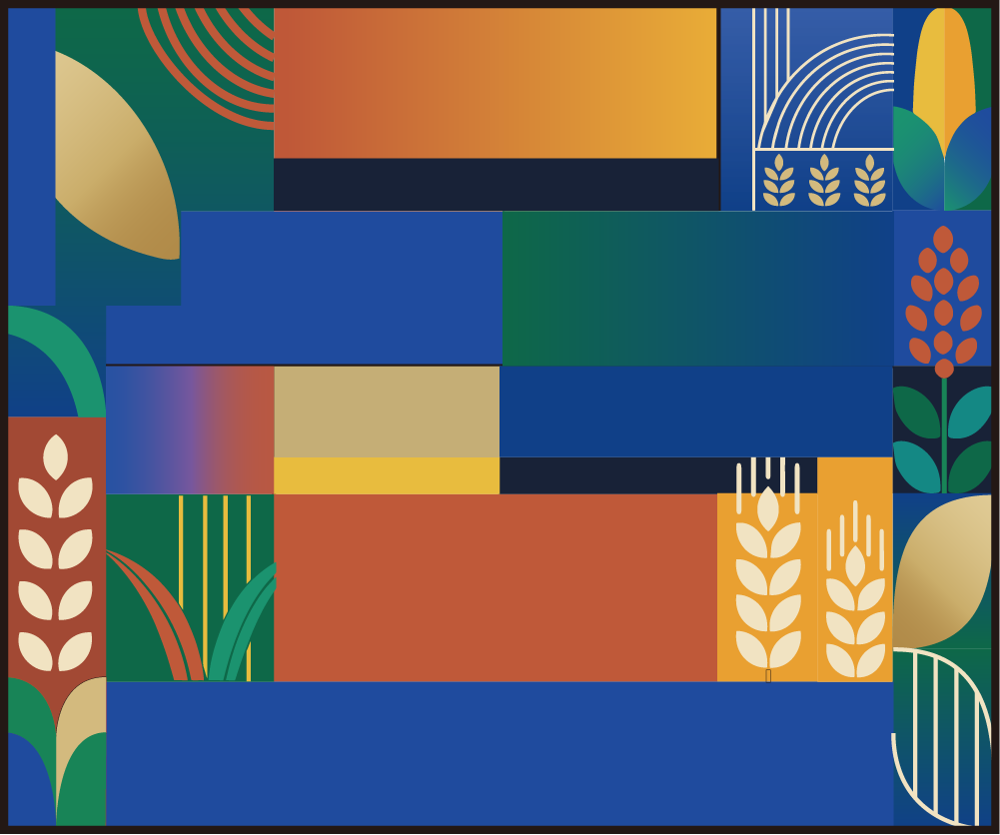
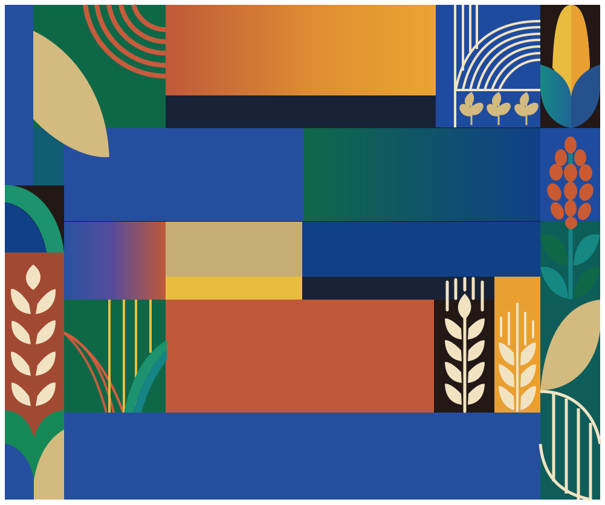
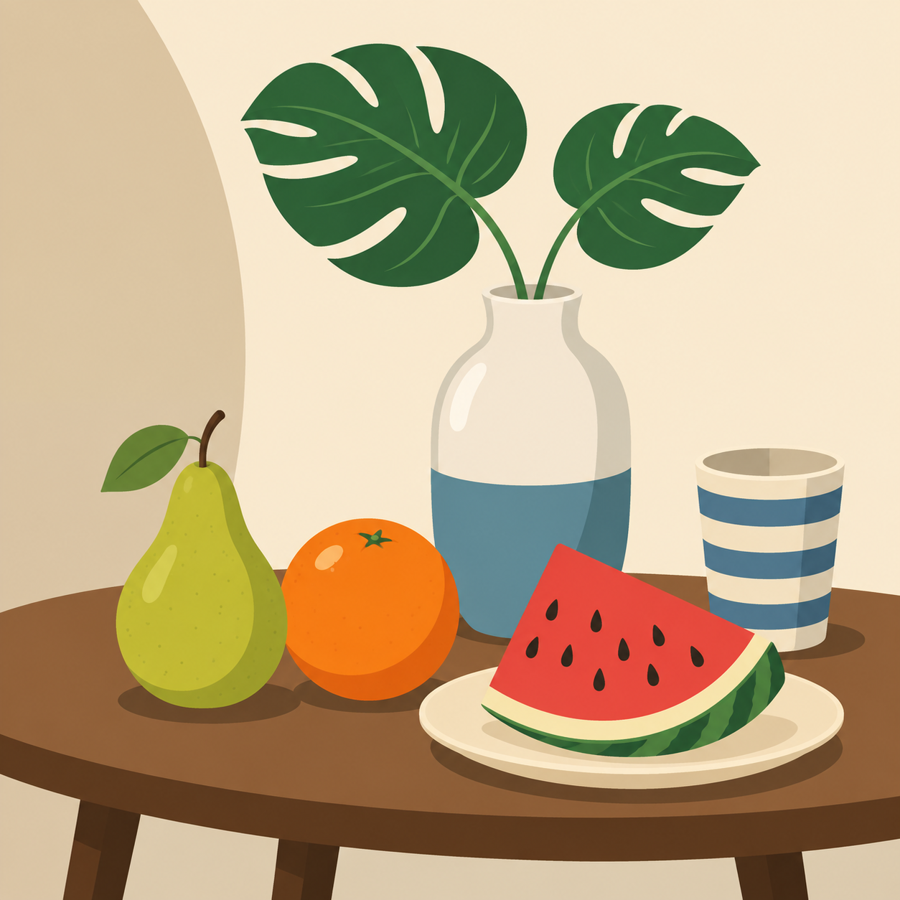
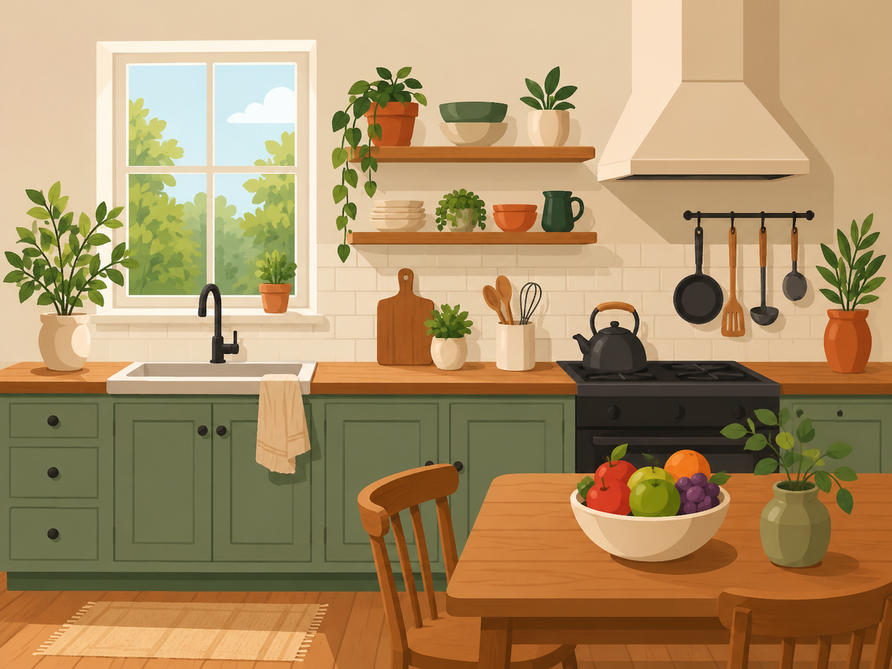
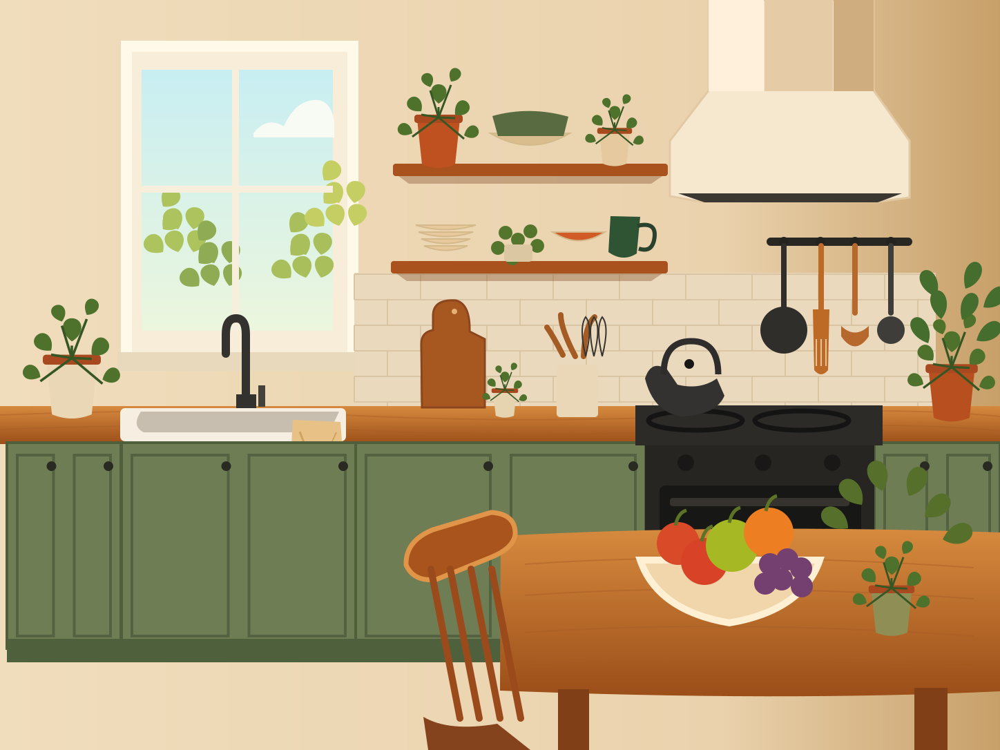
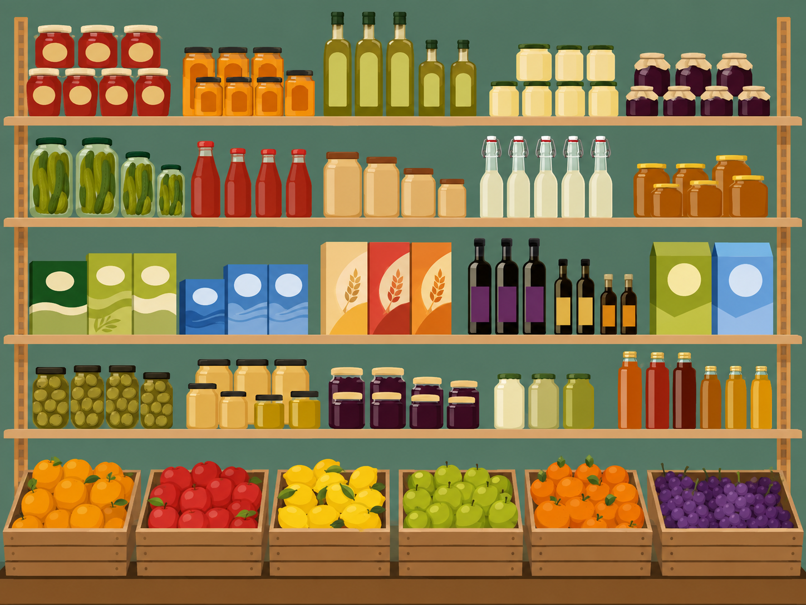
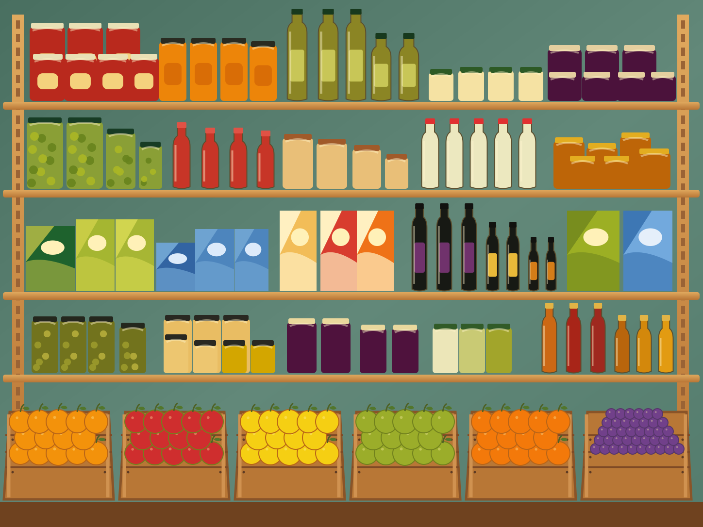

  <a href="README.md"><strong>English</strong></a> |
  <a href="README.zh-CN.md">简体中文</a>

# Clean Vector Reconstruction

Clean Vector Reconstruction is a small workflow for rebuilding flat and semi-flat raster illustrations as editable SVGs. It is most at home with clear colour regions, structured geometry, and repeated visual elements.

The aim is not to trace every pixel. It is to keep the drawing's important relationships in a form that can still be opened, understood, and adjusted in Adobe Illustrator.

## What it is for

References become semantic vector geometry: native primitives where they make sense, concise Bézier paths where they do not, and ordinary SVG fills, strokes, gradients, and groups throughout. Finished SVGs do not contain embedded or linked raster images.

Colour-block illustrations, still lifes, structured interiors, architectural scenes, and repeated systems are natural places to start. Complexity alone is not the dividing line. A busy scene can still be a good fit when its main parts separate cleanly, its boundaries are legible, and its spatial scaffold or repeated structure is stable.

This is not a general-purpose vectorizer or a tool for exact pixel tracing. Images that depend on a particular organic contour—such as articulated people, hands, hair, complex animals, heavy occlusion, or painterly texture—need more caution and often more drawing.

## Examples

These are representative examples, not accuracy claims. Each pair shows the source image beside an editable SVG reconstruction; the note below calls out the part of the drawing that made the example useful.

### Geometric Harvest

| Reference | Reconstructed SVG |
| --- | --- |
|  |  |

Geometric colour blocks, simple gradients, and shared edges make the underlying construction easy to follow.

### Still Life

| Reference | Reconstructed SVG |
| --- | --- |
|  |  |

Separate objects—fruit, vessel, leaves, and table—leave room for a few controlled organic curves without losing the structure of the scene.

### Winter Street

| Reference | Reconstructed SVG |
| --- | --- |
|  |  |

Although the street contains many parts, the buildings, roadway, lights, and snow layers can still be rebuilt as a readable set of structured objects.

### Kitchen Interior

| Reference | Reconstructed SVG |
| --- | --- |
|  |  |

Cabinets, shelving, appliances, and small repeated items give the room a stable scaffold before the local details are added.

### Market Shelf

| Reference | Reconstructed SVG |
| --- | --- |
|  |  |

Shelves, containers, product groups, and crates show how repeated elements can be organized as a system rather than drawn as unrelated fragments.

## How it works

Begin with the canvas, large regions, spacing, overlaps, and the main geometry. Meaningful objects come next; small details wait until the composition holds together.

The included Skill has two practical modes. `geometric-flat` suits aligned blocks, repeated units, regular geometry, and broad colour regions. `clean-flat` is for controlled free curves and mixed structured scenes. The output is then checked for sound SVG structure and for the absence of raster placement before visual review.

## Using the Skill

Copy `skill/clean-vector-reconstruction` to the Skill directory used by your project, then provide a reference image, output location, intended editor, and any publication constraints. The Skill produces layered and plain SVGs, a preview, and review files. A human still decides when the drawing is ready.

## Output and review

Layered SVGs retain useful groups for editing. Plain SVGs carry the same artwork in a simpler form for compatibility. Both use native SVG geometry and resources rather than placed raster content.

Automated checks are good at finding structural issues, but they cannot decide whether a drawing feels right or whether its remaining work is a local Illustrator edit rather than a redraw. That calls for visual review.

More detail is in [Methodology](docs/methodology.md), [Validation](docs/validation.md), and [Limitations](docs/limitations.md).

## License and example assets

Project-authored software and documentation are released under the [MIT License](LICENSE). Visual example assets have their own provenance notes; read the note supplied with an example before copying, modifying, or redistributing it.
