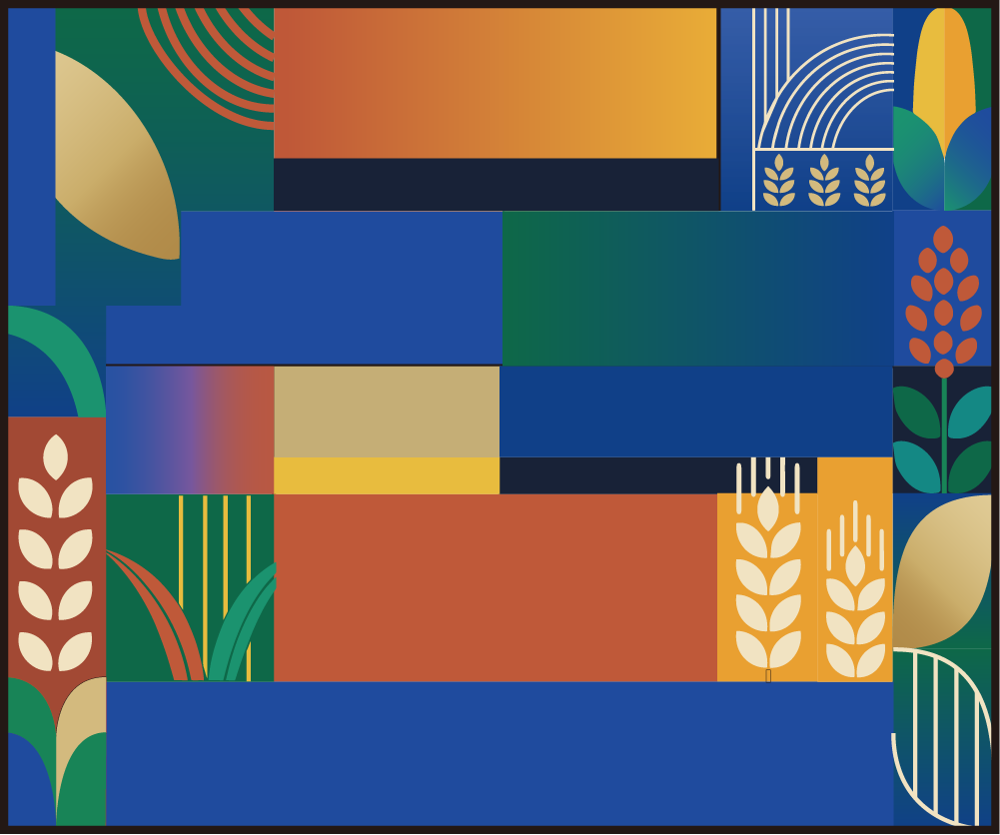
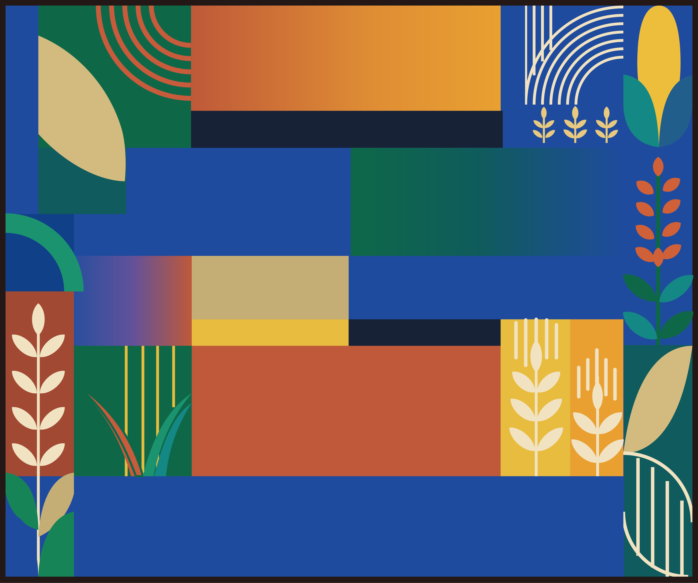

<p align="center">
  <a href="README.md">English</a> |
  <a href="README.zh-CN.md"><strong>简体中文</strong></a>
</p>

# Clean Vector Reconstruction

将扁平与半扁平位图插画重建为**干净、语义化、可在 Adobe Illustrator 中编辑的 SVG**。

> 结构优先，可编辑细节其次，像素相似度第三。

## 为什么做这个项目？

传统的位图转矢量工作流经常需要在两件事之间取舍：

- **追求高视觉相似度**，往往会生成大量碎片化路径，后期很难编辑。
- **追求干净的 SVG 结构**，虽然文件简洁，却可能在构图、几何关系或局部轮廓上偏离原图。

Clean Vector Reconstruction 尝试走一条中间路线：把原图重新构建为**少量具有明确语义的矢量对象**，优先保留主要结构和视觉关系，再利用基于原图的验证方法定位 SVG 与参考图之间仍存在的偏差。

它的目标不是完美自动描摹。

它真正追求的是：

**Illustrator-ready reconstruction（可直接进入 Illustrator 精修的重建结果）**——主要结构应当已经正确，Adobe Illustrator 只负责局部精修，而不是重新建图。

---

## 适合处理什么？

更适合具有以下特征的插画：

- 色块边界清晰
- 轮廓易于辨认
- 扁平或半扁平表现
- 纹理较少
- 语义对象明确
- 前景 / 中景 / 背景层次清楚

典型场景包括：

- 几何景观插画
- 编辑类扁平插画
- 海报式图形
- 简单角色插画
- 干净的装饰性场景

---

## 不适合处理什么？

本项目并不是为了替代：

- 照片矢量化
- 绘画感图像重建
- 高纹理图像描摹
- 高密度线稿描摹
- 像素级一比一复制

复杂的人物 / 动物肢体结构、密集透视场景、重纹理图像或低对比度模糊边界，仍可能需要额外的结构修正。

详见 [Limitations](docs/limitations.md)。

---

## 核心思路

整个工作流把重建拆成四个优先层级：

1. **Geometry skeleton（几何骨架）**  
   先锁定构图、主要比例、平面关系、间距、遮挡和大轮廓。

2. **Semantic structure（语义结构）**  
   将画面构建为有意义、可编辑的对象，而不是碎片化描摹路径。

3. **Local fidelity（局部保真）**  
   再处理特色元素、曲线、重复细节和 fill / stroke 等表现语义。

4. **Reference-grounded validation（基于原图的验证）**  
   直接比较 SVG 渲染结果与原始位图的边界，用于定位几何偏差，但不会把边界指标变成新的“描摹目标”。

最终要回答的并不是：

> “每个像素是不是完全一样？”

而是：

> “剩余差异能不能只通过 Illustrator 的少量局部编辑完成？”

---

## Illustrator-ready 的判断标准

只有满足以下条件，结果才会被视为可以进入 Illustrator 精修：

- 主要构图正确
- 主要对象比例可信
- 主要透视 / 平面关系正确
- 关键遮挡和连接关系正确
- 主要轮廓的起点 / 转折 / 终点关系正确
- 必需的语义区域没有缺失
- 不存在意外透明缺口
- SVG 保持干净且可编辑
- 不需要重新绘制任何主要对象

允许留给 Illustrator 的工作包括：

- 移动或缩放已有对象
- 调整少量锚点
- Bézier 手柄微调
- fill / stroke 调整
- 原生 SVG 渐变停止点调整
- 少量装饰细节修正

如果仍需要重画主要对象、人物姿态、建筑立面或主要景观区域，就**不能**判定为 Illustrator-ready。

---

## 重建模式

### `geometric-flat`

适合以下特征占主导的参考图：

- 几何色块
- 共享基线
- 重复结构
- 明确的平面关系
- 大面积清晰色块

### `clean-flat`

适合以下特征占主导的参考图：

- 有机轮廓
- 自由语义曲线
- fill / stroke 混合
- 角色或装饰性形体

模式由参考图本身决定，而不是预先强制指定。

---

## 验证层

### Structural quality（结构质量）

检查 SVG 完整性、资源、路径洁净度、layered/plain 一致性以及可编辑性代理指标。

### Semantic completeness（语义完整性）

检查必需对象类别和重复细节，避免为了“简化”而悄悄删除重要内容。

### Internal geometry consistency（内部几何一致性）

通过 landmarks、relations、planes 和 critical contours 检查重建结果是否符合已经建立的几何关系。

### Reference-grounded boundary evidence（基于原图的边界证据）

使用固定、由 reference 推导的边界提取方法，直接比较 SVG 渲染结果和原始位图。

支持：

- 双向边界距离
- 基于容差的 precision / recall / F1
- 区域级 mismatch 指标
- mismatch 可视化
- 有限局部修正

Boundary metrics 只是**诊断证据**，不是单一质量分，也不是重建目标。

---

## Reference-grounded correction（基于原图的有限修正）

对于适合的扁平插画，工作流可以进行有限的 correction loop：

```text
初始重建
   ↓
渲染
   ↓
直接与 reference 边界比较
   ↓
找到最大的 mismatch 区域
   ↓
只修正这些区域
   ↓
使用完全相同的验证配置重新渲染
```

这个修正循环会刻意限制次数。

禁止：

- 为提高 recall 增加大量碎片路径
- 为提高 precision 删除真实细节
- 为不同候选结果单独调整 threshold
- 为了更高指标牺牲 SVG 的语义结构和可编辑性

---

## 快速开始

### 1. 将 Skill 复制到你的项目

复制：

```text
skill/clean-vector-reconstruction
```

到项目级 Skill 目录：

```text
.agents/skills/clean-vector-reconstruction
```

### 2. 开始一次重建任务

示例：

```text
$clean-vector-reconstruction

Reconstruct this flat illustration as a clean, editable SVG.

Target:
- Adobe Illustrator
- preserve major composition and object relationships
- no embedded raster
- semantic editable objects
- structure must be correct before local detail
- remaining differences should be limited to Illustrator refinement
```

对于更严格的工作流，可以额外提供 case brief，明确：

- 目标编辑器
- 使用授权
- 输出目录
- 预期重建模式
- 关键区域
- 发布 / 隐私边界

### 3. 检查输出

常见输出可能包括：

- layered SVG
- plain SVG
- 渲染 preview
- overlay / difference diagnostics
- SVG audit
- object-family inventory
- geometry validation
- boundary comparison
- human-review template

---

## 示例结果

### Geometric Harvest

这是一张由作者原创的插画，使用 `geometric-flat` 工作流进行重建。

| 原始参考图 | 重建结果 |
|---|---|
|  |  |

公开文件：

- [Layered SVG](examples/geometric-harvest/output/layered.svg)
- [Plain SVG](examples/geometric-harvest/output/plain.svg)
- [案例说明](examples/geometric-harvest/notes.md)

这个案例主要用于展示清晰色块重建、语义化 SVG 结构以及面向 Illustrator 的可编辑性。

只有在参考图与重建结果都确认具备公开与再分发条件后，才会继续加入新的公开案例。

---

## 仓库结构

```text
clean-vector-reconstruction/
├─ README.md
├─ README.zh-CN.md
├─ LICENSE
├─ CHANGELOG.md
├─ .gitignore
├─ skill/
│  └─ clean-vector-reconstruction/
├─ examples/
│  ├─ README.md
│  └─ geometric-harvest/
│     ├─ reference/
│     │  └─ reference.png
│     ├─ output/
│     │  ├─ layered.svg
│     │  ├─ plain.svg
│     │  └─ preview.png
│     └─ notes.md
└─ docs/
   ├─ methodology.md
   ├─ validation.md
   └─ limitations.md
```

---

## 项目状态

当前重点：

- 干净的语义化 SVG 重建
- Illustrator-ready 输出
- 基于原图的验证
- 不依赖碎片化描摹的有限 correction

本项目仍处于实验阶段。实际效果会受到插画结构与复杂度影响。

---

## 文档

- [Methodology](docs/methodology.md)
- [Validation](docs/validation.md)
- [Limitations](docs/limitations.md)

---

## 许可证

本项目中由作者拥有权利的软件与文档采用 [MIT License](LICENSE)。

示例中的原始参考图与视觉输出可能适用单独的权利条款。在复制、修改或再分发视觉素材前，请先查看对应案例的说明文件。
